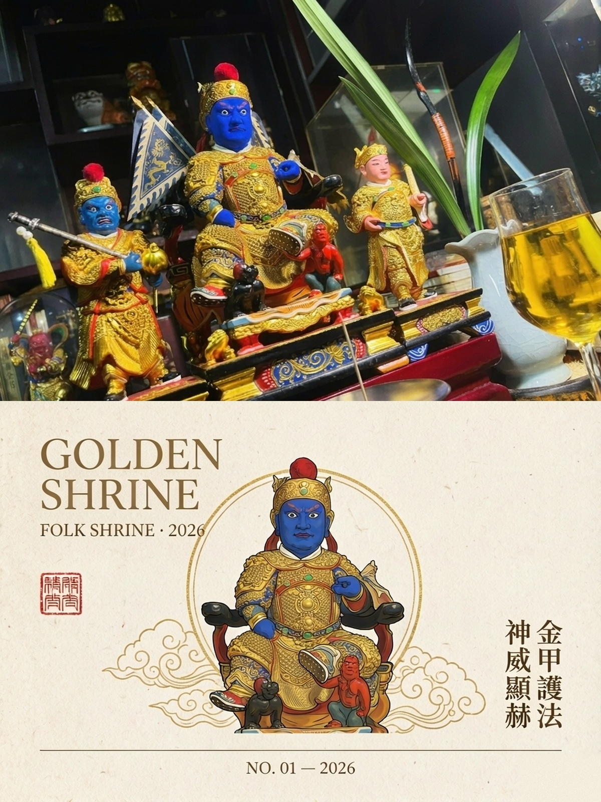
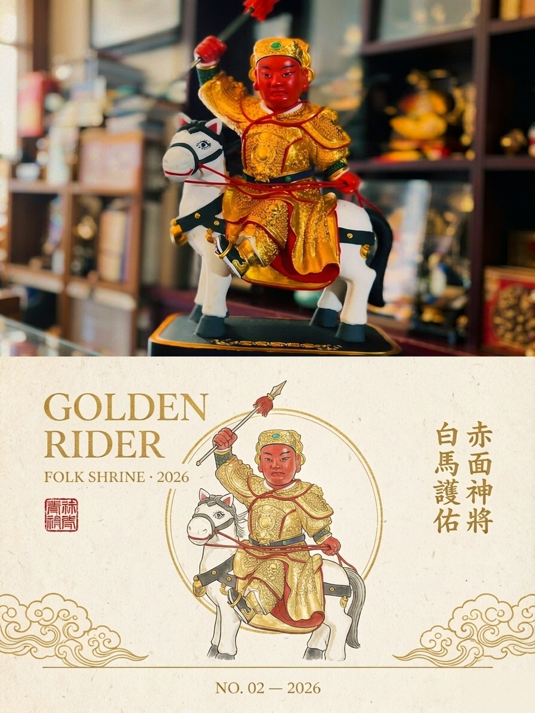
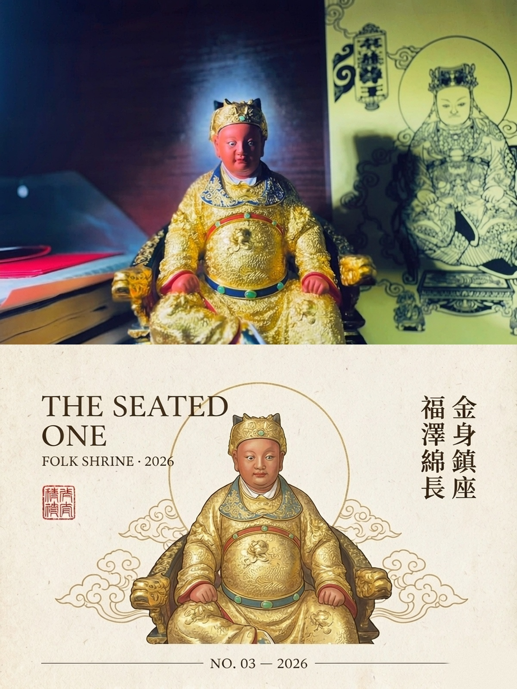

# deity-statue-poster 🪨

**神明雕像 · 庙宇文化海报生成器** —— 一个 AI Agent Skill：把神像照片逐张转成 3:4 直式高级庙宇文化海报。

上半部满铺保真实拍照片（仅轻微杂志调色），下半部米白底精致庙绘插画——金色光环、祥云纹、红色印章、衬线大字距英文标题、直排繁体中文、发丝线编号——并由程序锁定精确 50/50 分割、清除生成服务强制水印。

## 效果示例

| GOLDEN SHRINE | GOLDEN RIDER | THE SEATED ONE |
|:---:|:---:|:---:|
|  |  |  |

> 示例均为同一工作流的实际产出：左侧照片为原实拍（经模型轻微调色），下方插画配色完全取自照片本身。

## 安装

**WorkBuddy**：在 Skill 安装入口搜索或粘贴本仓库地址安装；或手动克隆后放入用户级 skill 目录：

```
~/.workbuddy/skills/deity-statue-poster/
```

**其他支持 Agent Skills 的环境**（Claude Code 等）：同样把整个文件夹放进 skills 目录即可，遵循 Anthropic Agent Skills 规范（SKILL.md + scripts/）。

## 触发方式

对 Agent 说类似的话即可触发：

- 「把这张神像照片做成庙宇风海报」
- 「这三张神像截图，一张一张做海报，不要拼接」
- 「帮我出一张宫庙文创风格的神将海报」

## 固定流程

1. **源图预处理**：手机截图先裁出真实照片区（去掉状态栏/UI）；
2. **图生图**：按四段式提示词模板生成（满铺照片 + 庙绘插画 + 逐字列明允许的文字）；
3. **质检**：照片保真、插画要素齐全、中英文逐字核对（含中文崩字回退方案）；
4. **程序合成**：`scripts/compose_poster.py` 锁定精确 50/50 分割、同色羽化修补水印；
5. **终检交付**：整图预览 + 右下角放大复查。

详细规范见 [SKILL.md](SKILL.md)。

## 依赖

- Pillow（合成脚本）
- ffmpeg（可选，截图裁切用）
- 图像生成服务（工作流内调用，每张约 5–10 积分成本）

## 输出规格

- 1200×1600（精确 3:4），JPG quality 95
- 分割线恒在画布垂直中点 y=800，由程序保证，不依赖生成模型
- 多张成系列时共享同一字体系统、命名气质与编号格式（NO. 01 — 年份）

## 适用范围

仅限**神明雕像 / 造像**题材。普通人物、宠物、产品、风景等场景请勿使用。

## License

MIT
